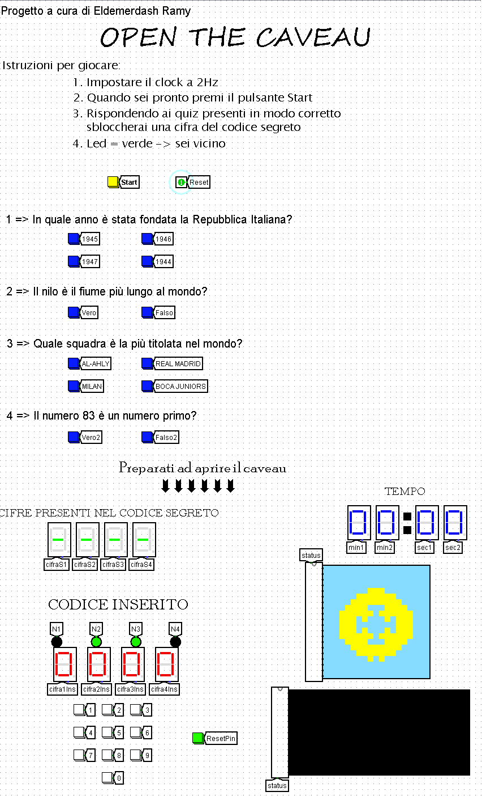
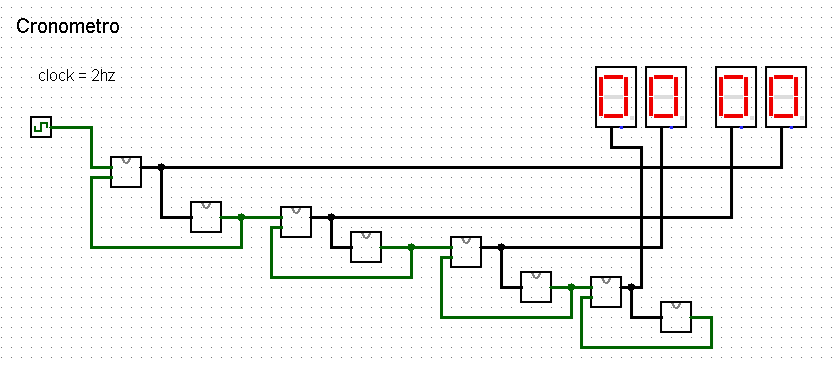

# Open the caveau (Logisim)

Progetto del corso di Architettura degli Elaboratori (Università degli Studi di Milano), realizzato con [Logisim](http://www.cburch.com/logisim/) 2.7.1. Contiene due circuiti:

- **Open the caveau**: un gioco interattivo in cui bisogna scoprire un codice segreto e inserirlo per aprire un caveau.
- **Cronometro**: un cronometro minuti:secondi, usato dal gioco.





## Come si gioca

1. Attiva il clock automatico seguendo le istruzioni nella sezione **Come attivare il clock automatico** qui sotto.
2. Premi **Start**: il codice segreto viene generato a caso e il cronometro parte.
3. Rispondi alle 4 domande del quiz: ogni risposta corretta svela una cifra del codice (in posizione diversa da quella finale). Una risposta errata non ha effetti.
4. Inserisci il codice con il tastierino. Accanto a ogni cifra un **LED verde** indica che sei vicino alla cifra segreta, un LED spento che sei lontano. Il pulsante **Reset Pin** cancella il codice inserito.
5. Il cronometro si ferma quando il codice è corretto o premendo Reset.

## Come attivare il clock automatico

Per fare in modo che il cronometro avanzi da solo dopo aver premuto **Start**, senza dover premere il pulsante a ogni incremento:

1. Apri il circuito in **Logisim**.
2. Dal menu **Simulate** (Simulazione), seleziona **Tick Frequency → 2 Hz**.
3. Sempre nel menu **Simulate**, abilita **Ticks Enabled** (Tick abilitati). Assicurati che sia presente il segno di spunta.
4. Premi **Start** una sola volta: il cronometro inizierà ad avanzare automaticamente.

**Nota:** se **Ticks Enabled** è disattivato, il clock non genera impulsi automatici e il cronometro potrebbe avanzare soltanto quando si interviene manualmente. La frequenza di **2 Hz** corrisponde a due tick del simulatore al secondo; la velocità effettiva del conteggio dipende dal circuito.

## Struttura del circuito

| Circuito | Ruolo |
|---|---|
| `main` | interfaccia: quiz, tastierino, display, cronometro, collegamento dei moduli |
| `passCode` | generazione casuale del codice segreto |
| `4BitSubtractor` | sottrattore a 4 bit, costruito con 4 `full-substractor` |
| `full-substractor` | sottrattore a un bit (porte AND, OR, XOR, NOT) |
| `near` | confronta la cifra inserita con quella segreta (due sottrattori e un comparatore) e pilota il LED di vicinanza |
| `statusCaveau` | mostra se il caveau è chiuso o aperto |
| `missionComplete` | messaggio finale |

Il cronometro (`cronometro/cronometro.circ`) usa quattro contatori a 4 bit (`count4Bit`, costruiti con flip-flop J-K), due circuiti `stop10` e due `stop6` che li azzerano a 10 e a 6, e quattro display esadecimali.

## Come aprirlo

Apri i file `.circ` con Logisim 2.7.1 o con [Logisim-evolution](https://github.com/logisim-evolution/logisim-evolution) (può chiedere di convertire il file). Servono Java e il programma; non ci sono dipendenze.

## Contenuto

```
caveau/open-the-caveau.circ
caveau/cronometro.circ
docs/relazione.pdf
images/caveau.png
images/cronometro.png
```

Per i dettagli sul funzionamento vedi `docs/relazione.pdf`.
